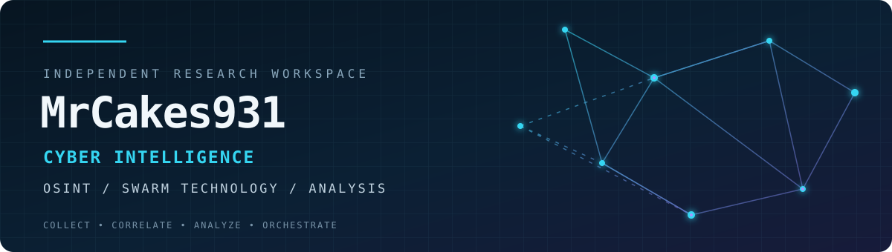

<!-- PCakes303 | Cyber Intelligence Workspace -->

<div align="center">



<br/>

**CYBER INTELLIGENCE · OPEN SOURCE INTELLIGENCE · SWARM TECHNOLOGY**

*Collect with purpose. Correlate with care. Turn signals into context.*

<br/>

<a href="https://github.com/PCakes303"></a>


</div>

---

## ◈ MISSION PROFILE

PCakes303 is an independent technical workspace exploring how open information, cyber context, and coordinated systems can be brought together to produce clearer intelligence.

The central interests are **Open Source Intelligence (OSINT)**, **cyber intelligence**, and **swarm technology** — including the methods, workflows, and architectures that connect collection, analysis, and coordination.

> **The goal is not to collect more noise. It is to discover meaningful connections.**

## ◈ INTELLIGENCE DOMAINS

<table>
<tr>
<td width="50%" valign="top">

### ⌕ Open Source Intelligence
- Public-source research
- Digital footprint analysis
- Domain and infrastructure research
- Source evaluation and verification
- Entity and relationship mapping

</td>
<td width="50%" valign="top">

### ⛨ Cyber Intelligence
- Cyber threat landscape research
- Internet-facing infrastructure context
- Exposure and risk research
- Technical investigation workflows
- Evidence-informed reporting

</td>
</tr>
<tr>
<td width="50%" valign="top">

### ⠿ Swarm Technology
- Multi-agent concepts and architectures
- Distributed task coordination
- Agent collaboration and delegation
- Parallel research workflows
- Human-supervised automation

</td>
<td width="50%" valign="top">

### ⌘ Intelligence Engineering
- Collection and processing pipelines
- Data enrichment and correlation
- Workflow automation
- Information visualization
- Reproducible documentation

</td>
</tr>
</table>

## ◈ HOW THE WORK CONNECTS

A useful intelligence workflow is more than a collection script. It needs a defined question, traceable sources, validation, and a clear account of uncertainty.

```text
          RESEARCH QUESTION
                  |
                  v
        +-------------------+
        |  SOURCE DISCOVERY |
        +-------------------+
                  |
                  v
        +-------------------+
        | COLLECTION &      |
        | NORMALIZATION     |
        +-------------------+
                  |
                  v
        +-------------------+
        | VALIDATION &      |
        | CORRELATION       |
        +-------------------+
                  |
                  v
        +-------------------+
        | ANALYSIS &        |
        | CONTEXT           |
        +-------------------+
                  |
                  v
        +-------------------+
        | HUMAN REVIEW &    |
        | REPORTING         |
        +-------------------+
```

Swarm and distributed approaches are an area of exploration across this workflow: independent workers can handle bounded tasks, while orchestration, provenance, and human review keep the overall process understandable.

## ◈ CURRENT RESEARCH TRACKS

| Track | Direction |
|---|---|
| **OSINT methods** | Repeatable, source-aware open-source research |
| **Cyber context** | Understanding domains, infrastructure, and digital exposure |
| **Swarm systems** | Coordinated agents, distributed tasks, and orchestration |
| **Data intelligence** | Enrichment, entity resolution, and relationship discovery |
| **Automation** | Observable workflows with meaningful human oversight |

## ◈ WORKSPACE MAP

| Path | Purpose |
|---|---|
| [`docs/RESEARCH_FRAMEWORK.md`](docs/RESEARCH_FRAMEWORK.md) | A practical framework for responsible, reproducible research |
| [`ROADMAP.md`](ROADMAP.md) | Public direction and project milestones |
| [`SECURITY.md`](SECURITY.md) | Security and responsible disclosure guidance |
| [`assets/`](assets/) | Visual assets used by this profile |

As projects become real and public, their repositories and write-ups will be linked here. No placeholder project is presented as completed work.

## ◈ OPERATING PRINCIPLES

- **Verify before concluding.** A lead is not a finding; corroborate important claims.
- **Preserve provenance.** Record where information came from and when it was observed.
- **Separate fact from inference.** Make confidence and uncertainty visible.
- **Automate with oversight.** Prefer bounded, observable tasks and human review.
- **Respect boundaries.** Work lawfully, ethically, and within authorization.
- **Document for repeatability.** Explain methods, limitations, and results.

## ◈ CONNECT

Interested in OSINT, cyber intelligence, distributed systems, or responsible automation? Explore the repositories as they are published or connect through [GitHub](https://github.com/PCakes303).

---

<div align="center">

**INTELLIGENCE IS MORE THAN COLLECTION.**  
**IT IS THE DISCOVERY OF CONNECTIONS.**

<sub><code>PCakes303 // CYBER INTELLIGENCE WORKSPACE</code></sub>

</div>
